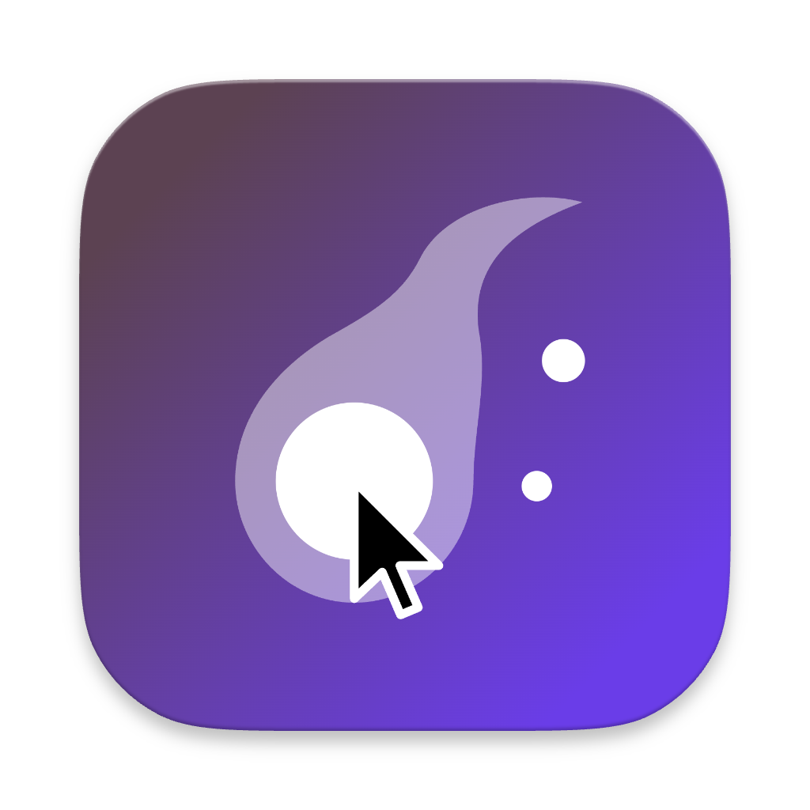

<p align="center">
  
</p>

<h1 align="center">Cursor Fatuus</h1>

<p align="center">
  A foolish fire for your cursor.<br>
  Soft glow that follows your pointer.
</p>

<p align="center">
  <a href="https://cursor-fatuus.vincent.codes">Website</a> ·
  <a href="https://github.com/vinzdef/cursor-fatuus/releases/latest/download/CursorFatuus.dmg">Download</a> ·
  <a href="https://ko-fi.com/vinzdef">Donate</a>
</p>

## Features

Small, quiet, always there.

- **Follows you.** Across every display and application, even full-screen.
- **Tint.** Optionally colored, at any opacity.
- **Blur & invert.** Calm the clutter under the pointer, or flip its colors so the cursor stands out.
- **Radius & softness.** From a crisp disc to a single gentle halo.
- **No weird permissions.** It never records or reads your screen. Nothing to approve.
- **Out of the way.** Lives in the menu bar. No Dock icon, no windows.

## Install

Open the [disk image](https://github.com/vinzdef/cursor-fatuus/releases/latest/download/CursorFatuus.dmg) and drag Cursor Fatuus into Applications. It shows up in your menu bar.

Requires macOS 14 or later.

## Release

Push a version tag and GitHub Actions builds a universal DMG, signs and notarizes it, and publishes the release:

```sh
git tag -a v0.2.0 -m "Cursor Fatuus 0.2.0"
git push origin v0.2.0
```

`make dmg` builds an ad-hoc signed DMG locally. `make notarize SIGN_ID="Developer ID Application: …"` signs and notarizes it, using the `cf-notary` profile from `xcrun notarytool store-credentials`.

## Build from source

```sh
make run
```

Needs Xcode or the Xcode Command Line Tools. The app is built to `build/Cursor Fatuus.app`.

Blur and invert use undocumented macOS APIs (`CABackdropLayer`), so a future macOS update may break them.

## Support

If Cursor Fatuus helps you, consider [donating on Ko-fi](https://ko-fi.com/vinzdef) or [sponsoring on GitHub](https://github.com/sponsors/vinzdef).
